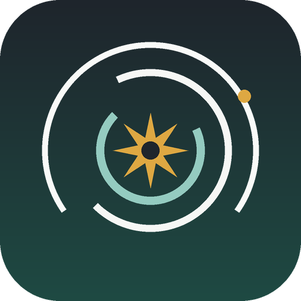
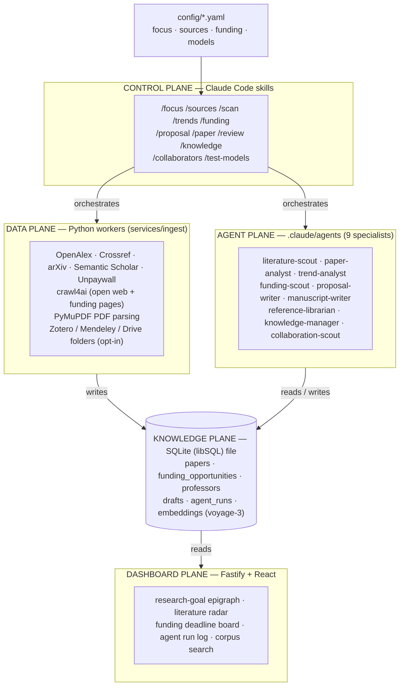

<div align="center">



# Scriptorium

**A self-updating map of your research field — papers, trends, and funding — paired with a disciplined writing engine grounded in each researcher's own corpus.**

[](LICENSE)
[](https://github.com/AmirAhmadianB/scriptorium-research-agent/actions/workflows/ci.yml)
[](https://nodejs.org)
[](https://www.python.org)
[](CONTRIBUTING.md)

</div>

---

## Table of contents

- [What this is](#what-this-is)
- [Who it's for](#who-its-for)
- [Architecture](#architecture)
- [Features](#features)
- [Quickstart](#quickstart)
- [Operating it from Claude Code](#operating-it-from-claude-code)
- [How it works](#how-it-works)
- [Configuration](#configuration)
- [Compliance & responsible use](#compliance--responsible-use)
- [Project structure](#project-structure)
- [Roadmap](#roadmap)
- [Contributing](#contributing)
- [License](#license)
- [Citation](#citation)

---

## What this is

Scriptorium is an agentic research-intelligence and drafting system for university departments. It continuously scans the open scholarly record — OpenAlex, Crossref, arXiv, Semantic Scholar, and Unpaywall — to keep an up-to-date picture of your field: which papers are new, which topics are rising or cooling, and which grants are open with deadlines that matter. It also drafts grant proposals and manuscript sections, but only ever grounded in the professor's *own* body of work, with hard rules against inventing citations, results, or dates.

You don't need to know anything about AI to use it. Behaviour is steered by four plain-text config files (your research goal, your sources, your funding radar, your model routing) and operated through simple slash commands inside [Claude Code](https://claude.com/claude-code). A local dashboard shows you what changed. Everything runs on your own machine or lab network — storage is a single local SQLite file, so there is no database server to administer and no cloud dependency for your data.

## Who it's for

- **University research groups and labs** that want one place where their literature landscape, funding pipeline, and writing all stay in sync.
- **Principal investigators** juggling grant deadlines and literature review who want the busywork automated without handing scientific judgement — or authorship — to a machine.
- **Departments** that need per-professor privacy scoping and a defensible, compliance-first posture toward publisher content and personal collections.

---

## Architecture

Scriptorium is organized into five planes. Config drives a **control plane** of Claude Code skills, which orchestrate a **data plane** of Python ingest workers and an **agent plane** of specialist subagents; both read and write a single **knowledge plane** (a local SQLite/libSQL file) that a thin **dashboard plane** renders. Full detail in [`docs/ARCHITECTURE.md`](docs/ARCHITECTURE.md).



---

## Features

<details open>
<summary><strong>Feature table</strong></summary>

| Feature | What it does |
|---|---|
| **Literature scanning** | Pulls new papers from OpenAlex, Crossref, arXiv, Semantic Scholar, and Unpaywall, scored against your research focus and deduplicated on a generated `dedupe_key`. |
| **Trend intelligence** | Turns the local corpus into counted signals — keyword velocity, rising authors, venue shifts, citation bursts — never from vibes; a trend needs two consecutive periods of movement. |
| **Funding radar** | Crawls configured Canadian and international sponsor pages with a crawl4ai-based crawler, extracts structured opportunity records, and ranks them by focus-match × feasibility, flagging anything closing within 30 days. |
| **Deep paper reading** | Parses OA PDFs with PyMuPDF and caches a structured deep-read (`structured_summary`) per paper, so expensive analysis happens once per paper, not once per question. |
| **Grounded grant drafting** | Fetches a funder's real evaluation criteria, maps an outline criterion-by-criterion, and drafts proposals cited to the group's actual papers — with `[[CONFIRM]]` placeholders where human input is required. |
| **Manuscript drafting** | Drafts journal-article sections for a scientific reader and a target venue's conventions, with a claims table (claim → supporting papers → strength) built before any prose. |
| **Referee-#2 review** | Critiques any draft on methodology, novelty, funder-criteria coverage, and internal consistency, quoting the weak sentence rather than gesturing at it. |
| **Consent-based corpus** | Indexes a professor's own library only through opt-in connectors (Zotero, Mendeley, watched PDF folders, cloud drives via OAuth), with per-professor scoping and private items excluded from cross-professor queries. |
| **Collaboration leads** | Surfaces internal and external collaborators on an evidence trail, keeping a hard wall between corpus-derived internal overlaps and public-metadata-only external leads. |
| **Local dashboard** | A Vite/React read-only window over the SQLite file: research-goal epigraph, literature radar, funding deadline board (red reserved for sub-30-day deadlines), and the agent run log. |
| **Evidence-based model routing** | Benchmarks candidate Claude models on the system's real tasks and reports quality/latency/cost so routing in `config/models.yaml` stays justified. |
| **Headless automation** | A Claude Agent SDK orchestrator (`apps/agents`) runs the same skills, agents, and guardrails from cron/Task Scheduler with no terminal open. |

</details>

---

## Quickstart

**Prerequisites:** Node 24, pnpm 10, Python 3.13, and [Claude Code](https://claude.com/claude-code) installed and logged in — ingest workers and the headless orchestrator shell out to the `claude` CLI and ride your existing subscription, no separate billed `ANTHROPIC_API_KEY` needed. No Docker either — storage is a single local SQLite file (`data/scriptorium.db`).

```bash
cp .env.example .env    # defaults work as-is; add API keys later for more sources
pnpm install
pnpm db:push            # Drizzle creates data/scriptorium.db
pnpm dev                # API :8787 + dashboard :5173
```

Open http://localhost:5173 — until the API is populated it shows labelled demo data.

To bring in real literature and funding, set up the Python ingest workers once, then run the scans:

```bash
cd services/ingest && pip install -r requirements.txt && crawl4ai-setup && cd ../..
pnpm scan               # first literature scan → SQLite
pnpm funding            # first funding-radar sweep
```

---

## Operating it from Claude Code

Run `claude` at the repo root. The project ships **11 slash-command skills** (under `.claude/skills/*/SKILL.md`) backed by **9 subagents** (under `.claude/agents/*.md`).

<details open>
<summary><strong>Slash commands</strong></summary>

| Command | What it does |
|---|---|
| `/focus` | Set or update the research focus (goal, fields, keywords, venues) that drives every scan, trend brief, and funding match. |
| `/sources` | Add, remove, or list the databases, APIs, and websites the system reads (refuses paywalled publisher domains). |
| `/scan` | Run a full literature + funding scan now — pull new papers, crawl configured pages, refresh opportunities, load into SQLite, and return a digest. |
| `/trends` | Produce a trend brief for the current focus — what's rising, cooling, who's publishing, emergent methods. |
| `/funding` | Refresh and rank open funding opportunities against the current focus, flagging anything closing within 30 days. |
| `/proposal` | Draft a grant proposal for a named funder and project, grounded in the corpus and the funder's evaluation criteria. |
| `/paper` | Draft or extend a manuscript section (intro, related work, methods, discussion) grounded in the local corpus. |
| `/review` | Critique a draft proposal or manuscript like a tough but fair referee, with a verdict. |
| `/knowledge` | Manage the corpus's knowledge sources — list, connect a consent-based source, sync, or audit privacy scoping, per professor. |
| `/collaborators` | Find collaboration leads for a topic or professor, with an evidence trail (internal vs. external lanes). |
| `/test-models` | Benchmark candidate Claude models on the system's real tasks and report quality/latency/cost so routing stays evidence-based. |

</details>

<details>
<summary><strong>Subagents (the 9 specialists)</strong></summary>

| Agent | Model | Role |
|---|---|---|
| `literature-scout` | Sonnet | Finds new papers across OpenAlex, Semantic Scholar, Crossref, and arXiv; recall first, honestly scored. |
| `paper-analyst` | Inherit (frontier) | Deep-reads a paper into a structured analysis — claim ledger, methods, evidence quality, limitations. |
| `trend-analyst` | Sonnet | Turns the corpus into quantitative trend signals — velocity, rising authors, venue shifts, citation bursts. |
| `funding-scout` | Haiku | Crawls and extracts funding opportunities into structured records matched to the focus. |
| `proposal-writer` | Inherit (frontier) | Writes long-form grant proposals in the group's voice, grounded in corpus and funder criteria. |
| `manuscript-writer` | Inherit (frontier) | Drafts journal articles for a scientific reader and a target venue — distinct from proposal-writer. |
| `reference-librarian` | Sonnet | Keeps the corpus clean — dedupe, metadata repair via Crossref/OpenAlex, connector sync, BibTeX. |
| `knowledge-manager` | Sonnet | The institutional-knowledge steward: consented ingestion, normalization, and privacy scoping. |
| `collaboration-scout` | Sonnet | Suggests collaborators with an evidence trail, keeping internal-corpus and external-metadata lanes separate. |

Anti-fabrication rules (never invent a DOI; `[[CITATION NEEDED]]` over a fake reference; uncertain dates are flagged, not guessed) live inside each agent's charter so grounding survives prompt drift.

</details>

For long autonomous work, paste the phase conditions from [`GOALS.md`](GOALS.md) into `/goal`. For unattended runs, schedule the headless orchestrator:

```bash
# cron / Task Scheduler
cd apps/agents && npx tsx src/orchestrator.ts "/scan"
```

---

## How it works

Scriptorium runs a closed loop. The four `config/*.yaml` files drive the Claude Code **skills**; each skill orchestrates the right combination of Python **ingest workers** (connectors, the crawl4ai crawler, PyMuPDF parsing, trend analysis) and Claude **subagents** (extraction, synthesis, drafting, review). Their results land in one local **SQLite (libSQL) file** — the only shared state — which the **dashboard** and the drafting skills read from. A new scan updates the map; an updated focus re-points the next scan; a funding match seeds a proposal that cites the corpus; a review closes the loop and the cycle repeats. Commercial tools each own one arc of that loop; Scriptorium's design goal is to own the whole loop. See [`docs/ARCHITECTURE.md`](docs/ARCHITECTURE.md) for the full walkthrough.

---

## Configuration

All behaviour is driven by four plain-text YAML files in `config/` — professors never touch code, and downstream agents pick up changes on their next run.

| File | Controls |
|---|---|
| [`config/focus.yaml`](config/focus.yaml) | The research question: goal statement, fields, include/exclude keywords, venues of interest, and how far back "current trends" looks. |
| [`config/sources.yaml`](config/sources.yaml) | Where literature comes from: the open scholarly APIs, open-web crawl targets, blocked (paywalled) domains, and per-professor library connectors. |
| [`config/funding.yaml`](config/funding.yaml) | The funding radar: sponsor pages to crawl, default scopes (national/provincial/internal), and the relevance match threshold. |
| [`config/models.yaml`](config/models.yaml) | Which Claude model runs which job, one line per task, plus the candidate set that `/test-models` sweeps. |

---

## Compliance & responsible use

> **Read [`docs/COMPLIANCE.md`](docs/COMPLIANCE.md) before touching `config/sources.yaml`.** This system touches two legally sensitive things — licensed scholarly content and professors' personal collections. Both have clean paths, and the code takes them.

**Publisher content: crawl nothing you log into.** University database subscriptions (ScienceDirect, SpringerLink, IEEE Xplore, Wiley, Web of Science, Scopus) are governed by license agreements that prohibit systematic downloading. Crawling them through EZproxy/Shibboleth with institutional credentials is the classic way a *whole campus* loses access — so those domains ship in `crawl.blocked_domains` and the `/sources` skill refuses to add them. The compliant routes, in order of preference:

1. **Open scholarly graph** — OpenAlex, Crossref, Semantic Scholar, arXiv, PubMed/PMC, Unpaywall, CORE. Metadata and abstracts for nearly everything, legal open-access full text for a large and growing fraction. This alone powers trends, discovery, and most drafting grounding.
2. **Publisher TDM APIs** — Elsevier, Springer Nature, Wiley and others offer text-and-data-mining APIs keyed to the institution's subscription; wire the institutional keys into the `apis.publisher_tdm` block. The license terms govern.
3. **Per-item, human-in-the-loop** — a professor manually saves a PDF they are licensed to read into their `library-inbox/` folder. The system just organizes what a human lawfully obtained.

**Professors' collections: consent, scope, residency.** Connectors are **opt-in per professor** and activate only with that professor's own credentials (Zotero read-only key, Mendeley official API, watched inbox folder, or cloud drives via OAuth) — never by scraping another person's local database. Everything ingested carries a `professor_id`; `private: true` / `is_private` items (unpublished drafts, in-review manuscripts) never appear in cross-professor search or trend statistics. Keep the database and any stored PDFs on infrastructure that matches your data-residency needs, and get a professor's explicit OK before any agent reads unpublished work.

**Authorship integrity.** Drafting agents are grounded and audited — citation keys must exist, no invented results, `[[CONFIRM]]` placeholders where human input is required — but the human remains the author. Check current tri-agency (NSERC/SSHRC/CIHR) and target-journal policy on AI assistance at submission time and disclose tool use where required.

---

## Project structure

<details>
<summary><strong>Directory tree</strong></summary>

```
scriptorium/
├── config/                 # control plane — behaviour lives here, not in code
│   ├── focus.yaml          #   research question, fields, keywords
│   ├── sources.yaml        #   literature APIs, crawl targets, connectors
│   ├── funding.yaml        #   funding radar sources and scopes
│   └── models.yaml         #   which Claude model runs which job
├── .claude/
│   ├── skills/             # 11 slash commands (operator interface)
│   └── agents/             # 9 specialist subagents
├── apps/
│   ├── api/                # Fastify + Drizzle schema (owns the DB)
│   ├── dashboard/          # Vite/React read-only ledger UI
│   ├── agents/             # headless Claude Agent SDK orchestrator (cron)
│   └── desktop/            # desktop app shell
├── services/
│   └── ingest/             # Python workers: connectors, crawler, PDF parse, trends
├── packages/
│   └── shared/             # shared TypeScript types/utilities
├── eval/                   # model-matrix harness, fixtures, tasks.yaml, report.md
├── desktop/                # launch shortcuts + icon assets
├── docs/                   # ARCHITECTURE · COMPLIANCE · MODEL-ROUTING
├── data/                   # local SQLite file (data/scriptorium.db)
├── GOALS.md                # ready-to-paste /goal conditions per build phase
├── CLAUDE.md               # project memory / mental model for Claude Code
└── package.json            # dev · db:push · scan · funding · eval
```

</details>

---

## Roadmap

Development runs in phases, each with a mechanically checkable `/goal` condition in [`GOALS.md`](GOALS.md):

1. **Foundation** — schema pushed, `/scan` populates the corpus.
2. **Funding radar** — crawler covers all `funding.yaml` sources; dashboard deadline board live.
3. **Deep reading** — PyMuPDF + paper-analyst caching `structured_summary` for every OA PDF.
4. **Drafting loop** — `/proposal` and `/paper` produce criterion-mapped, corpus-cited drafts; `/review` closes the loop.
5. **Hardening** — SSO, per-professor scoping enforced in the API, model routing re-benchmarked, deploy with data residency in mind.

---

## Contributing

Contributions are welcome — see [`CONTRIBUTING.md`](CONTRIBUTING.md). Please read [`docs/COMPLIANCE.md`](docs/COMPLIANCE.md) before proposing any change to how sources are fetched.

## License

Released under the [MIT License](LICENSE).

## Citation

If Scriptorium is useful in your own research tooling, please cite it — see [`CITATION.cff`](CITATION.cff).
